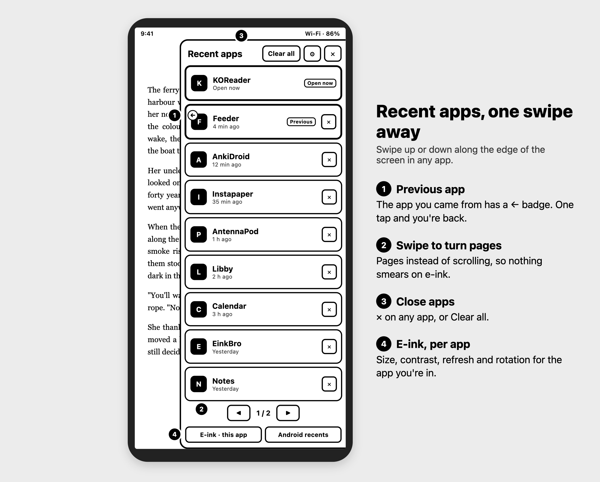
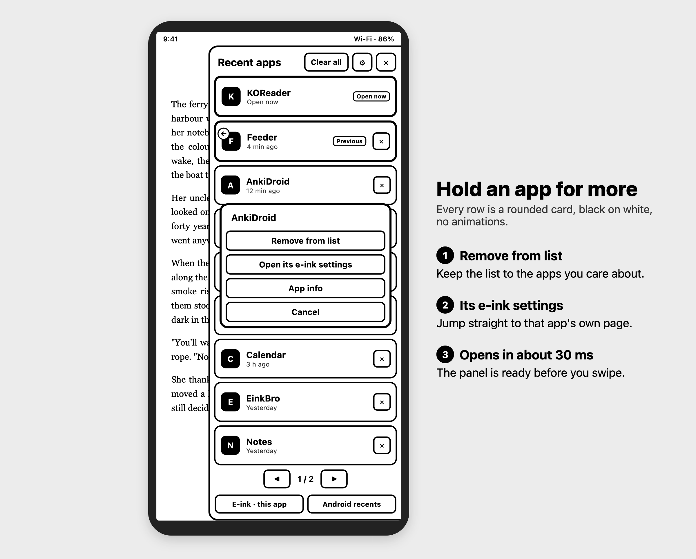
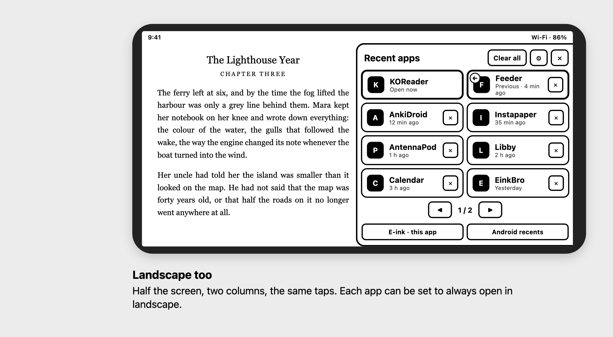
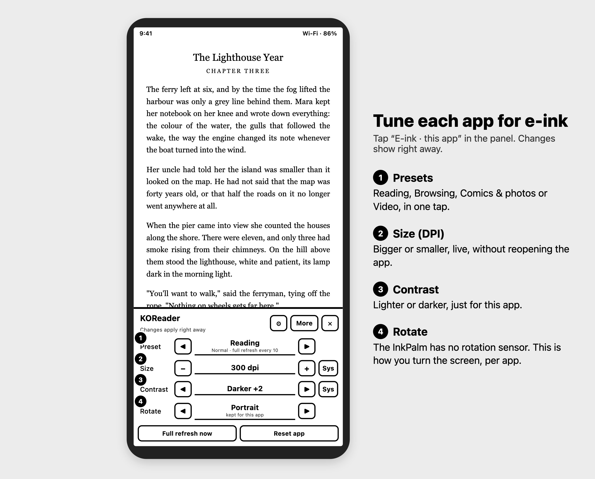
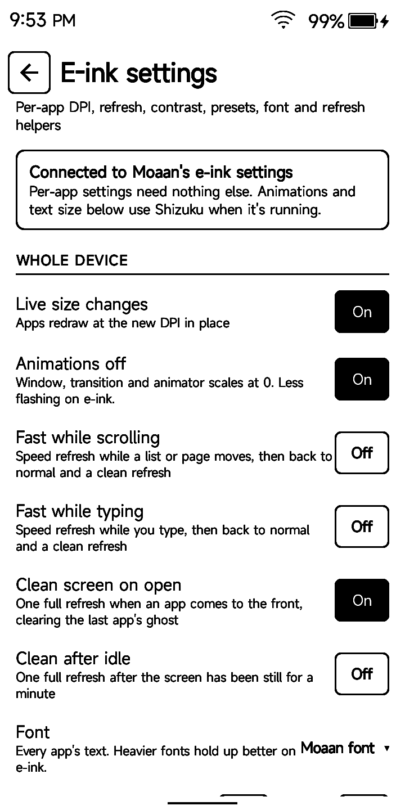
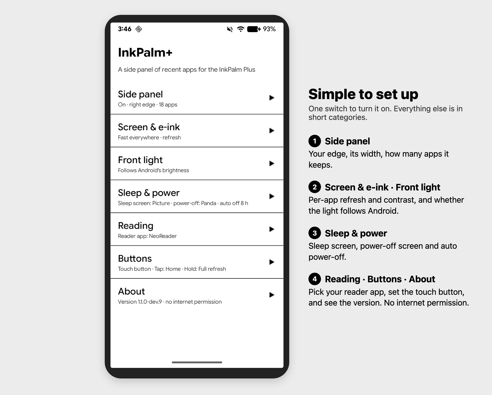

# InkPalm+

A **side panel of recent apps**, plus e-ink tuning for each app, for the Moaan InkPalm Plus.

Swipe up or down along the edge of the screen, in any app, and a panel slides in. It holds:

- your recent apps, newest first
- the app you were just in, one tap away
- a button for the e-ink settings of the app in front
- Clear all, and a ✕ on every app

You can also set each app's size, refresh mode and contrast, pick a font, and change what the touch button does.

No internet permission. Not affiliated with Moaan.

<p>
  
</p>

## Getting started

1. **Install.** Install [Obtainium](https://github.com/ImranR98/Obtainium) on the InkPalm. In Obtainium, tap **Add App**, paste `https://github.com/rn-os/inkpalm-plus`, then tap **Add** and **Install**. Obtainium will let you know when there's a new build.
   You can also download the latest `inkpalm-plus-….apk` from [Releases](https://github.com/rn-os/inkpalm-plus/releases) and open it on the phone.
2. **Open InkPalm+.** On the home screen, tap **Side panel**. It opens Android's Accessibility settings. Turn on **InkPalm+ quick panel**. This is the only required step.
3. **Swipe** up or down along the right edge of the screen.

The service only learns which app is in front, and that a page scrolled, text was typed or the screen changed. It doesn't read what's on screen or what you type.

## What's in the panel

From top to bottom:

| Part | Tap | Hold |
|---|---|---|
| **Clear all** | Closes every listed app except the one in front | |
| **⚙** | Opens InkPalm+'s home screen | |
| **✕** (top) | Closes the panel | |
| **An app** | Switches to it | Opens a small menu: **Remove from list**, **Open its e-ink settings**, **App info** |
| **✕** (on an app) | Closes the app and removes it from the list | |
| **◀ 1 / 2 ▶** | Turns the page. You can also swipe up or left for the next page, down or right for the previous one | |
| **E-ink · this app** | Opens the e-ink panel for the app in front (see below) | |
| **Android recents** | Opens Android's own recents | |

A few things to know:

- **Newest first.** The app open now says **Open now**. The one before it has a small **←** on its icon and a **Previous** tag. Tap it to go straight back.
- **Pages, not scrolling,** so nothing smears on e-ink. 9 apps fit on a page in portrait, 8 in landscape.
- **It's quick.** The panel opens in about 30 ms.
- **Clear all** leaves the app you're in. An app that's playing audio in the background may keep running after ✕.
- **Home screens and InkPalm+ itself** aren't listed. The list is kept across restarts.
- **Last read.** Pick your reader (NeoReader or KOReader) and the last book you read in it sits at the top. Tap it to keep reading. Hold it for your books, newest first, and **Browse files…** for anything new. KOReader needs Android's All files access, so InkPalm+ can read its history.



### Landscape

In landscape the panel is half the screen wide, with two columns.



## E-ink panel and settings

Tap **E-ink · this app** in the side panel (or hold an app and choose **Open its e-ink settings**). The panel opens over the app in front. It has four lines, each with ◀ and ▶. Tap the value to see the full list.



| Line | What it does |
|---|---|
| **Preset** | One choice for refresh and the refresh helpers: **System**, **Reading**, **Browsing**, **Comics & photos**, **Video**. Shows **Custom** if you've set something else on the app's page |
| **Size** | The app's DPI: System, or 120 to 560. **−** and **+** step by 10; the value's list has 200 to 400. 276 is the screen's own. Lower fits more on screen; higher makes everything bigger |
| **Contrast** | Lighter or darker, in 15 steps, while this app is open. **Sys** goes back to the system setting |
| **Rotate** | **Auto**, **Portrait**, **Landscape**, or either flipped. Remembered for each app. The InkPalm has no rotation sensor, so this is how you turn the screen |

At the bottom, **Full refresh now** flashes the screen once, and **Reset app** puts that app back to its defaults. **More** opens the app's own page, and **⚙** opens the home screen.

Changes apply right away and are saved, and Size redraws the open app in place. For that, turn on **Modify system settings** (see [Permissions](#permissions-and-privacy)). Without it, Size applies the next time you open the app.

New apps start on **System**, which leaves Moaan's own settings alone.

### Presets

| Preset | Refresh | Full refresh | Helpers |
|---|---|---|---|
| **System** | Moaan's own | Moaan's own | Follow the home-screen switches |
| **Reading** | Normal | Every 10 | Clean screen on open |
| **Browsing** | Normal | Every 20 | Fast while scrolling and typing |
| **Comics & photos** | Normal | Every 5 | Follow the home-screen switches |
| **Video** | Speed + dither | Moaan's own | All helpers off |

A preset only changes refresh and the helpers. It never touches Size, Contrast or Rotate.

### E-ink settings screen

On the home screen, tap **E-ink settings**.



**Whole device:**

- **Live size changes.** Opens the "Modify system settings" screen.
- **Animations off.** Turns window and transition animations off, for less flashing. Needs Shizuku, or the one-time `WRITE_SECURE_SETTINGS` grant below.
- **Refresh helpers.** Each is one switch for every app, and each app can override it on its own page:
  - **Fast while scrolling** (on). Speeds up refresh while a list or page moves, then goes back to normal and cleans the screen.
  - **Fast while typing** (on). The same while you type.
  - **Clean screen on open** (on). One full refresh when an app comes to the front, to clear the last app's ghost.
  - **Clean after idle** (off). One full refresh after the screen has been still for a minute. It's off because it can flash while you read a long page.
- **Font.** Android's Roboto and Noto Serif fonts, plus **Moaan font** (the one the device had before). Applies to every app, live. Heavier fonts hold up better at 16 grays.
- **Text size.** 0.70× to 1.60×.

**Apps.** Search, then tap an app for its own page. Tuned apps are listed first. The page has:

- **Size (DPI)**
- **Refresh mode:** System, Normal, Auto, Fast, Fast + 4 grays, Speed, Speed + dither
- **Full refresh:** System, or every 5, 10, 15, 20, 30, 50 partial updates
- **Contrast**
- **Refresh helpers:** Default, On or Off for this app. They apply right away
- **Moaan extras:** **Bleach**, **Bold text**, **Animation filter**. What they do depends on the app

Use **Save** to keep your changes, or **Save + reopen** to also close the app so it reopens at its new size. **Reset** puts the page back to the defaults, and you then **Save** it.

### Touch button

The button below the screen. On the home screen, tap **Touch button**.

- **Tap:** Back, Home, Page down, Volume down
- **Hold:** Full refresh, Screenshot, Page up, Volume up, Front light on/off, Home

These are the actions already built into the device. Changes apply on the next touch. For anything else, pick Page up or Volume up and map that key in a key-mapping app such as Key Mapper.

## Home screen



- **Side panel.** Opens Accessibility so you can turn the service on or off.
- **Reader app.** NeoReader, KOReader or None. You're asked once, the first time you open InkPalm+.
- **Strip side.** Left or Right.
- **Strip width.** 6 to 40 dp.
- **Show strip.** Draws a thin black line where you swipe.
- **Panel width.** 66, 78 or 90% of the screen, in portrait.
- **Apps kept.** 9, 18 or 27.
- **Clear recent apps.** Starts the list again.
- Rows that open **Touch button**, **E-ink settings** and **Keeping the panel on**.

## Keeping the panel on

On the home screen, tap **Keeping the panel on**. Both switches here are optional, and both need Shizuku or a one-time adb command.

- **Survives Clear Memory.** Moaan's Clear Memory force-stops every app that isn't on its whitelist, and Android then switches the panel off. This adds InkPalm+ to the whitelist. The screen shows the exact `adb shell "settings put system ..."` command if Shizuku isn't running.
- **Turns itself back on.** If the panel gets switched off by mistake, InkPalm+ switches it back on, when it opens and after a restart. This needs the `WRITE_SECURE_SETTINGS` permission, which the touch button settings also use. Tap the switch with Shizuku running, or run this once from a computer (it survives restarts and updates):

```
adb shell pm grant com.inkpalmplus android.permission.WRITE_SECURE_SETTINGS
```

Per-app settings work without Shizuku. If InkPalm+ can't reach them on your firmware, the E-ink settings screen says so and points you to [Shizuku](https://shizuku.rikka.app/).

## Permissions and privacy

- **No internet permission.** Nothing leaves the phone.
- **Required:** the accessibility service, **InkPalm+ quick panel**. It receives which app is in front, and that a page scrolled, text was typed or the screen changed. It doesn't read screen content or what you type.
- **Optional:**
  - **Modify system settings:** live size changes, and the font and text size.
  - **`WRITE_SECURE_SETTINGS`:** turning the panel back on, and the touch button. Granted once with Shizuku or adb.
  - **Shizuku:** the Clear Memory whitelist, and a fallback for Animations off and for reaching Moaan's settings.
  - **Kill background processes:** used by ✕, **Clear all** and **Save + reopen**.
  - **Run at startup:** checks after a restart that the panel is back on.
- The recent-apps list and your choices stay on the phone. **Clear recent apps** empties the list.

## Limits

- Tested only on the **InkPalm Plus**, firmware `MAS_EPD305_L81B804_T44_V09`, Android 11. Other Moaan models may differ.
- The e-ink features use Moaan's firmware. They won't work on other phones. The side panel itself is plain Android, but it hasn't been tried elsewhere.
- Android doesn't let apps read its recents, so the list only has apps that came to the front **after** InkPalm+ was switched on.

### Before you uninstall

Some changes live in the phone, not in InkPalm+, so they stay after you uninstall it. Undo them first:

- **Per-app size and refresh:** on each app you tuned, tap **Reset app** in the e-ink panel, or **Reset** then **Save** on the app's page.
- **Font:** set it back to **Moaan font** under E-ink settings.
- **Text size,** and **Animations off** if you turned it on, are system settings too.
- **Touch button:** set Tap and Hold back to what you want.
- **Clear Memory whitelist:** InkPalm+ stays on it. Remove it from Moaan's list if you care.

## Building

You don't need to: download the APK from [Releases](https://github.com/rn-os/inkpalm-plus/releases). To build it yourself:

`./gradlew assembleDebug` needs JDK 17 and the Android SDK (set `sdk.dir` in `local.properties`). Then install it:

```
adb install -r app/build/outputs/apk/debug/app-debug.apk
```

## For developers

- `docs/screenshots`: real screenshots from the device (the pictures above are drawn from the same UI by `docs/launch/build.py`).
- `CLAUDE.md`: project layout, how to build and test, and product direction.
- `docs/firmware.md`: what was learned about the InkPalm's firmware (Moaan's per-app table, how DPI and refresh are applied, live changes). Check it before decompiling anything.
- `tools/device-test.sh`: scripted checks over adb (`tools/device-test.sh list`, then `run all`). See `tools/README.md`.
- `docs/mockups`: the UI mockups, built by `docs/mockups/build.py`.

The UI is built in code (`Ui.kt`), black on white, with no animations. The only libraries are Shizuku's API and HiddenApiBypass.
